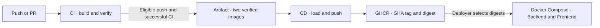

# Bonus 01 · CI/CD for Obsidian Compute

## Objective

Batch 05 introduced CI/CD after Core Acceptance. The pipeline automatically checks the application build and behavior as changes are integrated, then publishes the exact two Docker images that passed verification. Commit-based tags and registry digests allow teammates to retrieve the correct version for reproduction or demonstration. The workflow continued to support subsequent Bonus and remediation batches.

GitHub Actions runs in the repository and reports results for commits or pull requests. GHCR belongs to the same GitHub ecosystem and allows the publishing job to use `GITHUB_TOKEN`. Docker Compose reuses the submission deployment: Nginx, PostgreSQL, Redis, two Core API replicas, Realtime Gateway, Notification Worker, Frontend, Mailpit and Elasticsearch. The workflow provides **Continuous Delivery** by publishing verified images. Starting the Compose stack is a separate deployment action. The project does not claim automatic deployment to a server (**Continuous Deployment**).

## Architecture and workflow



CI runs on a GitHub-hosted `ubuntu-24.04` runner for pushes to `fix-issue` or `main` and PRs targeting those branches. `progress` and `backup-main` are excluded.

1. Check out the candidate commit, configure Node.js 24 and install locked dependencies with `npm ci`.
2. Run `npx playwright install --with-deps chromium` to install Chromium and its system dependencies, then run `npm run build` to verify the production build.
3. Extract the commit's `source` tree into a temporary directory using `git -C "$GITHUB_WORKSPACE" archive HEAD:source`. Build the Backend and Frontend `linux/amd64` images from the existing Dockerfiles. Assign the full commit SHA as the tag and OCI revision label during the build. The clean build also downloads the pinned AI model assets and verifies their checksums.
4. Run `npm run verify -- --images` against those exact images. The verifier checks the isolated Compose project's PostgreSQL database, the Backend/OAuth fixtures, Playwright Chromium tests and application container image IDs. A failure in a required step fails CI.

CD runs only for eligible pushes in the original repository after the `verify` job succeeds. CI saves the two images with `docker save` and uploads the `verified-images` artifact with one-day retention. The `publish` job downloads the artifact from the same run, loads it with `docker load`, uses `GITHUB_TOKEN` with `packages: write`, and pushes both SHA tags to GHCR. It records the manifest digests reported by the registry in the run summary. CI has read-only repository-content permission; PRs verify but do not publish. Job timeouts are 20 minutes for `verify` and 10 minutes for `publish`. [Current workflow](https://github.com/PeterPhan2005/Obsidian-compute/blob/068bb1eca89283241544310186b3da95e122abee/.github/workflows/ci-cd.yml)

## Running the released version

Use the Compose files, Nginx configuration and catalog media from [commit `068bb1eca89283241544310186b3da95e122abee`](https://github.com/PeterPhan2005/Obsidian-compute/commit/068bb1eca89283241544310186b3da95e122abee). Use Docker with Linux amd64 support and modern Compose v2. Ensure ports 8080 and 8025 are available; stop only a demo stack that you own before starting a different stack. In PowerShell, from `source/`:

```powershell
$env:OBSIDIAN_BACKEND_IMAGE = 'ghcr.io/peterphan2005/obsidian-compute-backend@sha256:14ed59c43493822c49e35d6d7da430e55507292f1df9241870c782dd01dd3d61'
$env:OBSIDIAN_FRONTEND_IMAGE = 'ghcr.io/peterphan2005/obsidian-compute-frontend@sha256:58777cd5614050c915acbef7e180ba1f85cafb469f0c6560d564c08e12363e14'
$compose = @('-p', 'obsidian-delivered', '-f', 'docker-compose.yml', '-f', 'compose.images.yaml')
docker pull --platform linux/amd64 $env:OBSIDIAN_BACKEND_IMAGE
docker pull --platform linux/amd64 $env:OBSIDIAN_FRONTEND_IMAGE
docker compose @compose up -d --no-build
docker compose @compose ps --all
curl.exe --fail http://localhost:8080/api/v1/health
```

Open `http://localhost:8080` (storefront) and `http://localhost:8025` (Mailpit on the Docker host). Init, `api-a`, `api-b`, `realtime` and `worker` share the Backend image; `frontend` uses the Frontend image. If the packages are private, authenticate with GHCR using a classic PAT with `read:packages` and permission to read both packages. Public packages support anonymous pulls. Never display credentials. For the normal source-based submission, run **`docker compose up -d`** from `source/` without the image override; no GHCR login is required. [Source deployment instructions](https://github.com/PeterPhan2005/Obsidian-compute/blob/068bb1eca89283241544310186b3da95e122abee/source/README.txt)

When finished, run `docker compose @compose stop` to stop only this demo stack and retain its volumes. A temporary IPAM override outside the repository may be required if the local Docker address pool is exhausted. Choose a non-overlapping subnet; do not delete unrelated networks or volumes.

## Development history and verification evidence

### Historical Batch 05 evidence

- Core was accepted before the pipeline was introduced. [Core baseline `f53ab3d`](https://github.com/PeterPhan2005/Obsidian-compute/commit/f53ab3dd659ad40d374d413c0d7cc81b38a2ab71).
- The first workflow push to `fix-issue` failed during Docker build because the archive command ran from `source/` and produced an empty archive, causing `ambiguous Dockerfile source`. The publish job was skipped. [Commit `f32426a`](https://github.com/PeterPhan2005/Obsidian-compute/commit/f32426ac4bf84ebf155ec9583c144b925ff7eb6a) · [Run 45767628794](https://github.com/PeterPhan2005/Obsidian-compute/actions/runs/45767628794).
- The correction changed the build context to the extracted source directory. The next run passed **74/74** (46 Backend/OAuth and 28 Playwright); `publish` loaded the verified artifact and succeeded. [Commit `ab48843`](https://github.com/PeterPhan2005/Obsidian-compute/commit/ab48843896a2440c110dccbd00159392cbc6ae00) · [Run 45768557009](https://github.com/PeterPhan2005/Obsidian-compute/actions/runs/45768557009).
- Both packages used tag `ab48843896a2440c110dccbd00159392cbc6ae00`. The historical Backend manifest digest was `sha256:0703f961b8b428cef8721499254fa493d920471862c8acad9acd0e9db7c30f1a`; the Frontend digest was `sha256:3300d0e14dcdcc589eff545184398dafe717510afe0d2f2816e819af0c93ddb3`. The Batch 05 pull and OCI revision checks matched that commit. [Historical publish log](https://github.com/PeterPhan2005/Obsidian-compute/actions/runs/45768557009/job/139736372897).
- The clean Compose project `obsidian-batch05-ghcr-c54ad351f0` ran those historical digests with `--no-build`. Init exited 0, both API replicas were healthy, the worker was running and all five application container image IDs matched at that checkpoint. Health, storefront, catalog images and Mailpit returned HTTP 200. The verification stack was stopped.

### Current release evidence

Final Technical Acceptance: [`068bb1e`](https://github.com/PeterPhan2005/Obsidian-compute/commit/068bb1eca89283241544310186b3da95e122abee) on `fix-issue`. [GitHub Actions run 45983344230, attempt 1](https://github.com/PeterPhan2005/Obsidian-compute/actions/runs/45983344230) passed the production build, both image builds and **112/112** verification results (66 Backend/OAuth and 46 Playwright). The [`verify` job 140452548674](https://github.com/PeterPhan2005/Obsidian-compute/actions/runs/45983344230/job/140452548674) verified all six application container image IDs and exported `verified-images` (artifact ID `15190671043`, archive SHA-256 `fe31fdb75a6d3298fbd2d370b945efc854000df54855f698e55bed1a9d31eeef`). The [`publish` job 140455407773](https://github.com/PeterPhan2005/Obsidian-compute/actions/runs/45983344230/job/140455407773) loaded that artifact without rebuilding and published both full-commit-SHA tags. The technical advisor independently checked the remote commit, Actions jobs and test results, artifact metadata, and registry manifest digests against the publish logs. Codex performed and reported the local image configuration digest comparisons and delivered-image execution: both images were pulled by digest, run with `--no-build` using Compose from the exact commit, and passed **112/112** in the isolated verifier. Init exited `0`; all six application container image IDs matched. A temporary IPAM override addressed local Docker address-pool exhaustion; isolated stacks were stopped with volumes retained.

The current manifest digest references are the two values in the running instructions above. [GHCR packages](https://github.com/PeterPhan2005?tab=packages). A registry manifest digest identifies a published manifest; it is not the same as the image configuration digest used as the local image ID. The historical runs and measurements retain their original checkpoint identity and are not current-run measurements.

## Demonstration sequence

1. Open the historical failed run. Show the build failure and skipped publish job, then the corrective commit. This demonstrates that CI was used during development, not added solely for submission.
2. Open current run `45983344230`, attempt 1. Show the full commit SHA, successful production/image builds, 66 Backend/OAuth and 46 Playwright results, the `verified-images` artifact export, then the `publish` job loading that artifact rather than rebuilding.
3. Show the full-SHA package tags and two manifest digests in the run summary/publish logs and GHCR package versions, where accessible. Run the released-image commands above and show `--no-build`, init completion, running services, HTTP health and working storefront/catalog.
4. Explain that the normal submission starts from source with `docker compose up -d`. GHCR is the delivery destination; deployment of the demo stack is explicit.

The artifact is retained for one day. If it is expired, use the actual saved evidence, export/publish logs and metadata still accessible; do not imply that an expired artifact was downloaded again. The instructor determines Bonus credit.

### Screenshots to capture during the narrated demo

The following filenames are coordinated with the Vietnamese recording script. Save actual captures under `Bonus/evidence/`. The files listed here are capture targets, not a claim that the screenshots already exist. Retain the relevant commit, test result, service state, or visible application output; omit credentials, tokens and private information.

| Filename | Evidence to show |
|---|---|
| `ci-01-failed-run.png` | Historical build failure and skipped publish job. |
| `ci-02-verify.png` | Final run, commit, verification job and successful 66 Backend/OAuth / 46 Playwright results (capture separate views if necessary). |
| `ci-03-publish.png` | Final artifact load/publish log, full-SHA tags and manifest digests. |
| `ci-04-packages.png` | Accessible GHCR Backend and Frontend package versions; use separate captures if needed. |
| `ci-05-delivered.png` | Digest-pinned `--no-build` startup, container status and health; use separate captures if needed. |
