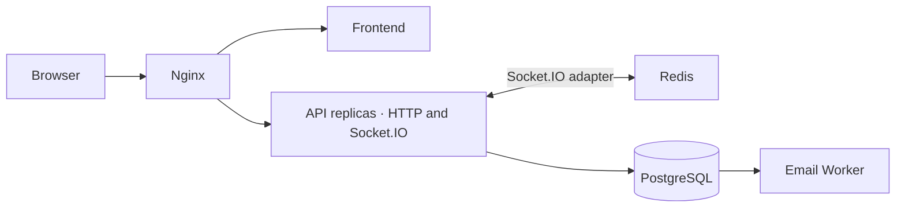
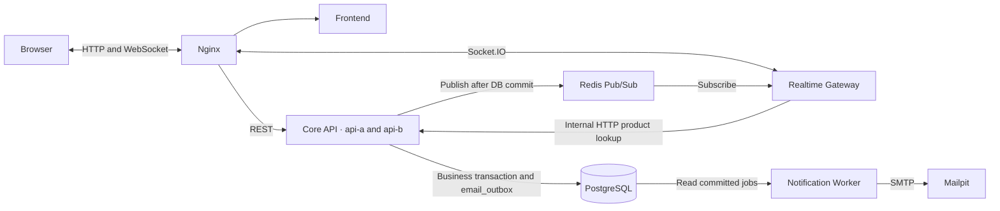

# Bonus 02 · Microservices for Obsidian Compute

## Objective

Page 6 of `NodeJS Final Project.pdf` requires at least three services in addition to the Frontend and database, with evidence of asynchronous communication through an intermediary such as Redis. Batch 06 implemented three application services with separate entry points and lifecycles: Core API, Realtime Gateway and Notification Worker. The two API replicas belong to the same Core API service. Nginx, Redis, Mailpit and init are supporting components; Elasticsearch was added later for product search and is not needed to inflate the three-service count.

## Architecture before and after Batch 06

Before Batch 06, each Core API replica served both HTTP and Socket.IO. A Redis adapter distributed events among replicas. An independent worker already processed email from the PostgreSQL outbox.



Since Batch 06, Nginx maintains one browser origin, routes `/api/v1/` to two Core API replicas, and routes `/socket.io/` to a separate Realtime Gateway.



1. **Core API** handles authentication, catalog, checkout and administration. After writing a comment or rating to PostgreSQL, Core publishes `comment.created` or `rating.updated` to `obsidian:realtime:products`. The publisher uses a separate Redis connection, with timeout/error handling outside the transaction. HTTP still reflects the committed write when the Gateway is stopped or publishing fails. The public comment representation is consistent across HTTP and realtime.
2. **Realtime Gateway** subscribes to Redis and sends events to the appropriate Socket.IO product room. It checks Origin, validates product IDs and serializes join/leave handling. When a client joins, it asks Core whether the product is active through an internal HTTP lookup with a 1.5-second timeout. Nginx exposes the lookup only on its internal listener and blocks that route on the public port. The Gateway does not require PostgreSQL access or business credentials.
3. **Notification Worker** reads jobs from `email_outbox` using `FOR UPDATE SKIP LOCKED` and sends email through SMTP. Core writes order confirmations, OTP and reset-password jobs in the relevant transactions. Checkout can commit while the Worker is stopped; queued email is processed after the Worker returns. Retries use backoff and a stable `Message-ID`. The final remediation checks the current validity of OTP/reset challenges before sending, including supported legacy jobs; invalid jobs are marked `discarded` with `AUTH_CHALLENGE_INVALID`.

After Socket.IO reconnects, the client rejoins its product room and reads current data through REST. If the initial internal lookup times out, the client retries on the same connection. If only the Redis subscriber is interrupted, the Gateway emits `product.resync` after resubscribing, prompting the browser to fetch current data through REST even if its WebSocket remains open.

The final Nginx configuration uses a shared upstream zone and Docker DNS re-resolution for the two Core replicas. This addresses stale upstream addresses after Core container recreation. Core instances share PostgreSQL-backed application data rather than requiring browser affinity; Redis mediates the realtime events. This diagram focuses on the three application services and their asynchronous paths; the separate search architecture is described in Bonus 03.

## Running the released version

Use the Compose files, Nginx configuration and catalog media from [commit `068bb1eca89283241544310186b3da95e122abee`](https://github.com/PeterPhan2005/Obsidian-compute/commit/068bb1eca89283241544310186b3da95e122abee). Use Docker with Linux amd64 support and modern Compose v2. Ensure ports 8080 and 8025 are available; stop only a demo stack that you own before starting a different stack. In PowerShell, from `source/`:

```powershell
$env:OBSIDIAN_BACKEND_IMAGE = 'ghcr.io/peterphan2005/obsidian-compute-backend@sha256:14ed59c43493822c49e35d6d7da430e55507292f1df9241870c782dd01dd3d61'
$env:OBSIDIAN_FRONTEND_IMAGE = 'ghcr.io/peterphan2005/obsidian-compute-frontend@sha256:58777cd5614050c915acbef7e180ba1f85cafb469f0c6560d564c08e12363e14'
$compose = @('-p', 'obsidian-microservices-demo', '-f', 'docker-compose.yml', '-f', 'compose.images.yaml')
docker pull --platform linux/amd64 $env:OBSIDIAN_BACKEND_IMAGE
docker pull --platform linux/amd64 $env:OBSIDIAN_FRONTEND_IMAGE
docker compose @compose up -d --no-build
docker compose @compose ps --all
curl.exe --fail http://localhost:8080/api/v1/health
```

Open `http://localhost:8080` (storefront) and `http://localhost:8025` (Mailpit on the Docker host). Init, `api-a`, `api-b`, `realtime` and `worker` share the Backend image; `frontend` uses the Frontend image. If the packages are private, authenticate with GHCR using a classic PAT with `read:packages` and permission to read both packages. Public packages support anonymous pulls. Never display credentials. For the normal source-based submission, run **`docker compose up -d`** from `source/` without the image override; no GHCR login is required. [Source deployment instructions](https://github.com/PeterPhan2005/Obsidian-compute/blob/068bb1eca89283241544310186b3da95e122abee/source/README.txt)

When finished, run `docker compose @compose stop` to stop only this demo stack and retain its volumes. A temporary IPAM override outside the repository may be required if the local Docker address pool is exhausted. Choose a non-overlapping subnet; do not delete unrelated networks or volumes.

## Demonstration sequence

1. Show the post-Batch 06 architecture and `docker compose @compose ps --all`. Identify the three services, two Core replicas and completed init. Open the same product in two separate browser sessions. Submit a comment and show its arrival in the other window without reloading. Check the exact Redis channel with `docker compose @compose exec -T redis redis-cli PUBSUB NUMSUB obsidian:realtime:products`.
2. Run `docker compose @compose stop realtime`. Submit a new comment while the Gateway is stopped, showing that Core HTTP still commits the write. Run `docker compose @compose start realtime`. Show the observing window recovering current state through REST when WebSocket reconnects, then send another comment to confirm live updates.
3. Run `docker compose @compose stop worker` on the isolated demo stack. Complete a synthetic checkout. Show the successful order and the absence of its confirmation email in Mailpit. Run `docker compose @compose start worker`; wait for and open the confirmation email for the same order number. This demonstrates asynchronous email processing without blocking checkout.
4. Call the health endpoint repeatedly to show both `X-Instance-Id` values. Stop one Core replica, verify that requests reach the other, then start it again and check readiness. This is evidence of routing and failover, not a production load benchmark.
5. Show current Actions run `45983344230`, the **112/112** result, the verify-before-publish sequence, and the digest-pinned deployment evidence in Bonus 01. Stop the demo stack while retaining volumes.

## Verification evidence and limitations

### Historical Batch 06 evidence

- Baseline: [commit `ab48843`](https://github.com/PeterPhan2005/Obsidian-compute/commit/ab48843896a2440c110dccbd00159392cbc6ae00). [Commit `35d7324`](https://github.com/PeterPhan2005/Obsidian-compute/commit/35d7324423b8a0e941d3c88d548842b86b74d70c) was accepted by the technical advisor. [Actions run 45777143382](https://github.com/PeterPhan2005/Obsidian-compute/actions/runs/45777143382) passed **76/76** (47 Backend/OAuth and 29 Playwright), including Gateway, Redis subscriber and Worker recovery.
- The verifier matched runtime image IDs for six application containers, including completed init and the Gateway. At this checkpoint the verify and publish job timeouts were 20 and 10 minutes. Publish loaded the same-run artifact; full-SHA tags, OCI revision labels and the two digests were checked. [Historical publish log](https://github.com/PeterPhan2005/Obsidian-compute/actions/runs/45777143382/job/139764568023). Historical Backend digest: `sha256:bdc3f001d9bb6aed724bc5250c29ddea200d23cc3f5c6ae60901b084a2a5d5b6`; Frontend: `sha256:34bb9d57eba34adee11e44349884d226f108ba59e81f2d3b4e3f6adc0c08085e`.
- The clean project `obsidian-batch06-ghcr-caa0097fcc` ran those historical images with `--no-build`. Init exited 0; both Core replicas and the Gateway were healthy; Worker was running; six container image IDs matched. A probe received HTTP 201 from `api-a` and then `comment.created` through Redis and the Gateway with matching product and comment IDs. The verification stack was stopped.

### Current release evidence

Final Technical Acceptance: [`068bb1e`](https://github.com/PeterPhan2005/Obsidian-compute/commit/068bb1eca89283241544310186b3da95e122abee) on `fix-issue`. [GitHub Actions run 45983344230, attempt 1](https://github.com/PeterPhan2005/Obsidian-compute/actions/runs/45983344230) passed the production build, both image builds and **112/112** verification results (66 Backend/OAuth and 46 Playwright). The [`verify` job 140452548674](https://github.com/PeterPhan2005/Obsidian-compute/actions/runs/45983344230/job/140452548674) verified all six application container image IDs and exported `verified-images` (artifact ID `15190671043`, archive SHA-256 `fe31fdb75a6d3298fbd2d370b945efc854000df54855f698e55bed1a9d31eeef`). The [`publish` job 140455407773](https://github.com/PeterPhan2005/Obsidian-compute/actions/runs/45983344230/job/140455407773) loaded that artifact without rebuilding and published both full-commit-SHA tags. The technical advisor independently checked the remote commit, Actions jobs and test results, artifact metadata, and registry manifest digests against the publish logs. Codex performed and reported the local image configuration digest comparisons and delivered-image execution: both images were pulled by digest, run with `--no-build` using Compose from the exact commit, and passed **112/112** in the isolated verifier. Init exited `0`; all six application container image IDs matched. A temporary IPAM override addressed local Docker address-pool exhaustion; isolated stacks were stopped with volumes retained.

Codex's final delivered-image checks also reported successful Core recreation with changed IP addresses without restarting Nginx, distribution to both replicas after recovery, successful routing to the remaining replica when one Core stopped, cross-replica realtime events, and Worker recovery with expired/used/superseded authentication challenges discarded. The current regression suites include `auth-outbox.test.js` and `public-comments.test.js`, as well as the realtime and checkout tests. The acceptance evidence covers the implemented behaviors; it does not establish unlimited scalability or exactly-once SMTP delivery.

### Known limitations

Redis Pub/Sub does not persist events for replay. If only the publisher fails after commit while the subscriber and WebSocket remain connected, a notification may be lost until the client reads REST again. PostgreSQL remains shared. The Gateway is a single instance, so stopping it temporarily interrupts realtime. SMTP may redeliver if a worker stops after the server accepts a message but before the database records `sent`. Challenge validation occurs before SMTP submission, not at guaranteed delivery time. External SMTP delivery and production load capacity remain unverified. The evidence establishes independent service lifecycles and recovery in Compose, not database-per-service architecture or full service high availability. The instructor determines Bonus credit.

### Screenshots to capture during the narrated demo

The following filenames are coordinated with the Vietnamese recording script. Save actual captures under `Bonus/evidence/`. The files listed here are capture targets, not a claim that the screenshots already exist. Retain the relevant commit, test result, service state, or visible application output; omit credentials, tokens and private information.

| Filename | Evidence to show |
|---|---|
| `micro-01-services.png` | Core replicas, Realtime Gateway, Notification Worker and supporting services in Compose. |
| `micro-02-realtime.png` | Two product windows showing the same newly submitted comment without reload. |
| `micro-03-redis.png` | Subscriber count for `obsidian:realtime:products`. |
| `micro-04-recovery.png` | Core comment succeeds while Gateway is stopped; reconnected observer and subsequent update (separate captures if needed). |
| `micro-05-worker-stopped.png` | Successful order number, stopped Worker and Mailpit without that order email (separate captures if needed). |
| `micro-06-worker-recovered.png` | Matching order-confirmation email after Worker starts. |
| `micro-07-scaling.png` | Both instance IDs and successful health response from the remaining Core during failover (separate captures if needed). |
