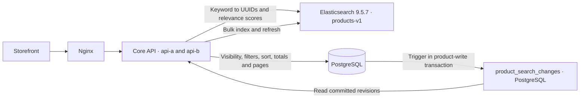

# Bonus 03 · Elasticsearch Product Search for Obsidian Compute

## Objective

Page 6 of `NodeJS Final Project.pdf` requires Elasticsearch integration to support fast and relevant product search. Batch 07 integrated Elasticsearch into storefront keyword search. Catalog queries without a keyword and Admin search continue to use PostgreSQL.

## Architecture and synchronization



1. Elasticsearch uses the product UUID as the document ID. Searchable fields are name, brand, short description and tags. The query analyzes the keyword into tokens, requires all tokens across the fields, and boosts names, brands, tags and name-phrase matches. Core uses a point-in-time snapshot and `search_after` when multiple result batches are needed.
2. PostgreSQL applies product, category and variant visibility, the lowest active-variant price, filters and explicit sorting. Core uses the complete matched UUID set to calculate totals and pagination, with UUID as the tie-breaker for equal relevance or sort values. A product with an active variant remains visible when its stock is exhausted. Checkout checks current authoritative price and inventory. Catalog selection and pagination use a consistent database read snapshot.
3. A trigger records the UUID and revision in the same transaction as changes to searchable product content. After init completes, both Core replicas periodically check the queue. An advisory lock allows one replica to synchronize at a time. Core reads committed changes, sends revision-aware bulk requests (`external_gte`) and removes only the processed revision. When Elasticsearch fails, queued changes are retained for retry. If the index is lost, Core rebuilds it from PostgreSQL with a predefined mapping, catches up and refreshes before exposing the alias. Searchable content is eventually synchronized; visibility and filters remain authoritative in PostgreSQL.
4. The API returns `X-Search-Backend: elasticsearch` when it uses Elasticsearch. If the index is unavailable, a query fails, exceeds 1.5 seconds or matches more than 50,000 results, Core runs the full SQL query and returns `X-Search-Backend: postgresql`. SQL uses substring matching and prioritizes name matches for relevance sorting. Token-based Elasticsearch and SQL can therefore produce different matched sets and ordering.

## Running the released version

Use the Compose files, Nginx configuration and catalog media from [commit `068bb1eca89283241544310186b3da95e122abee`](https://github.com/PeterPhan2005/Obsidian-compute/commit/068bb1eca89283241544310186b3da95e122abee). Use Docker with Linux amd64 support and modern Compose v2. Ensure ports 8080 and 8025 are available; stop only a demo stack that you own before starting a different stack. In PowerShell, from `source/`:

```powershell
$env:OBSIDIAN_BACKEND_IMAGE = 'ghcr.io/peterphan2005/obsidian-compute-backend@sha256:14ed59c43493822c49e35d6d7da430e55507292f1df9241870c782dd01dd3d61'
$env:OBSIDIAN_FRONTEND_IMAGE = 'ghcr.io/peterphan2005/obsidian-compute-frontend@sha256:58777cd5614050c915acbef7e180ba1f85cafb469f0c6560d564c08e12363e14'
$compose = @('-p', 'obsidian-search-demo', '-f', 'docker-compose.yml', '-f', 'compose.images.yaml')
docker pull --platform linux/amd64 $env:OBSIDIAN_BACKEND_IMAGE
docker pull --platform linux/amd64 $env:OBSIDIAN_FRONTEND_IMAGE
docker compose @compose up -d --no-build
docker compose @compose ps --all
curl.exe --fail http://localhost:8080/api/v1/health
docker compose @compose exec -T elasticsearch curl -fsS http://127.0.0.1:9200/products-v1/_count
curl.exe -fsS -i 'http://localhost:8080/api/v1/products?q=Studio%2016&category=laptop'
```

Open `http://localhost:8080` (storefront) and `http://localhost:8025` (Mailpit on the Docker host). Init, `api-a`, `api-b`, `realtime` and `worker` share the Backend image; `frontend` uses the Frontend image. If the packages are private, authenticate with GHCR using a classic PAT with `read:packages` and permission to read both packages. Public packages support anonymous pulls. Never display credentials. For the normal source-based submission, run **`docker compose up -d`** from `source/` without the image override; no GHCR login is required. [Source deployment instructions](https://github.com/PeterPhan2005/Obsidian-compute/blob/068bb1eca89283241544310186b3da95e122abee/source/README.txt)

When finished, run `docker compose @compose stop` to stop only this demo stack and retain its volumes. A temporary IPAM override outside the repository may be required if the local Docker address pool is exhausted. Choose a non-overlapping subnet; do not delete unrelated networks or volumes.

If the count request returns 404 immediately after startup, wait for Core to create the alias and retry. Start recording when the request through Nginx reports `X-Search-Backend: elasticsearch`. Elasticsearch is limited to 1 GiB, has a project-scoped volume and shares a dedicated internal network with the two Core replicas. Its port is not published on the host.

## Demonstration sequence

1. Show init, Elasticsearch and both Core replicas. Display the alias document count and search for `Studio 16` with the Laptop category. Show Obsidian Studio 16 and the Elasticsearch header in DevTools or the API response. The unchanged seed also has 18 results for `Northstar`, as recorded at the accepted checkpoint.
2. Use `http://localhost:8080/api/v1/products?q=Obsidian&category=laptop&brand=Obsidian&maxPrice=100000000&sort=name_asc&pageSize=1&page=1`, then repeat with `page=2`. At the historical clean-seed checkpoint the API reported four matches and four pages with different products on the two pages. Show the actual current result; do not hard-code counts if the demo catalog has changed. Also show filtering and numbered pagination in the Catalog UI.
3. On the isolated stack, add a unique keyword to an active product name. Wait for the search index to catch up, then search for that keyword and show the result with the Elasticsearch header. Archive the demo product and show it no longer appears in the public Catalog. PostgreSQL visibility remains authoritative even if index synchronization is delayed.
4. Run `docker compose @compose stop elasticsearch`. Search for a known keyword such as `Northstar` and show `X-Search-Backend: postgresql`. Run `docker compose @compose up -d elasticsearch`, wait for index readiness and show that `X-Search-Backend: elasticsearch` returns. Do not delete the index or its volume during the recording.
5. Show the final Actions result and release evidence in Bonus 01. Stop only the demo stack, retaining volumes and keeping private credentials outside the recording.

## Verification evidence and limitations

### Historical Batch 07 evidence and benchmarks

- [Actions run 45803094915](https://github.com/PeterPhan2005/Obsidian-compute/actions/runs/45803094915) at [commit `f74cabe`](https://github.com/PeterPhan2005/Obsidian-compute/commit/f74cabeb48ec8b93f51423949ed9b829eba6f9c8) passed **82/82** (53 Backend/OAuth and 29 Playwright). Six search tests covered real searches from both Core replicas, index initialization, filtering/pagination across multiple batches, concurrent changes, rollback, fallback, catch-up and rebuilding. CI checked all six application container image IDs. Publish used the two images from the verified artifact.
- The remote runner used the committed Compose configuration and default network pool. The historical local delivered-image stack used Backend digest `sha256:05d4361f82c1041b678310d34dc5e0b7745d9a04beb74a65ea925cbaea8bce22` and Frontend digest `sha256:05b8a603216fda1f6d14a4b14fa2c33bc8a1c5a702801ec2c8086aa11bed1204`, with init exit 0, six matching image IDs, and search, pagination and API-update checks. Local Docker needed a temporary IPAM subnet because its default pool was exhausted.
- A local benchmark used 60 seed products, three warmed queries (`Obsidian`, `Forma`, `Northstar`), matching brand filters, `name_asc`, 12 products per page and 30 full responses per mode. Median/p95 were **23.7/32.1 ms** for Elasticsearch and **15.8/23.1 ms** for direct SQL with Elasticsearch not configured. Both returned the same IDs, order and total for this query group.
- An earlier local probe through Nginx measured **26.7/35.2 ms** for Elasticsearch and **58.8/82.9 ms** for SQL fallback while the search node was stopped. The fallback measurement included the failed Elasticsearch connection attempt. It is not a direct-SQL comparison. These are historical light-load measurements on the seed catalog, not a new benchmark at the final commit.

### Current release evidence

Final Technical Acceptance: [`068bb1e`](https://github.com/PeterPhan2005/Obsidian-compute/commit/068bb1eca89283241544310186b3da95e122abee) on `fix-issue`. [GitHub Actions run 45983344230, attempt 1](https://github.com/PeterPhan2005/Obsidian-compute/actions/runs/45983344230) passed the production build, both image builds and **112/112** verification results (66 Backend/OAuth and 46 Playwright). The [`verify` job 140452548674](https://github.com/PeterPhan2005/Obsidian-compute/actions/runs/45983344230/job/140452548674) verified all six application container image IDs and exported `verified-images` (artifact ID `15190671043`, archive SHA-256 `fe31fdb75a6d3298fbd2d370b945efc854000df54855f698e55bed1a9d31eeef`). The [`publish` job 140455407773](https://github.com/PeterPhan2005/Obsidian-compute/actions/runs/45983344230/job/140455407773) loaded that artifact without rebuilding and published both full-commit-SHA tags. The technical advisor independently checked the remote commit, Actions jobs and test results, artifact metadata, and registry manifest digests against the publish logs. Codex performed and reported the local image configuration digest comparisons and delivered-image execution: both images were pulled by digest, run with `--no-build` using Compose from the exact commit, and passed **112/112** in the isolated verifier. Init exited `0`; all six application container image IDs matched. A temporary IPAM override addressed local Docker address-pool exhaustion; isolated stacks were stopped with volumes retained.

Codex's final delivered-image checks reported successful Elasticsearch search, PostgreSQL fallback and search recovery. The search regression suite is `source/backend/tests/product-search.test.js`. The current release retains the documented search architecture; the final remediation additionally maintains public catalog visibility and consistent reads. The original timing evidence is retained at its historical checkpoint and has not been remeasured for this documentation update.

### Known limitations

The measured seed-catalog performance does not demonstrate a speed advantage over direct SQL. Performance on a large catalog or under concurrent production load has not been measured. Elasticsearch and SQL use different matching and relevance algorithms; equivalent results are not guaranteed for all queries. Index synchronization is asynchronous. The technical advisor accepted the verified implementation scope, while the instructor determines Bonus credit.

### Screenshots to capture during the narrated demo

The following filenames are coordinated with the Vietnamese recording script. Save actual captures under `Bonus/evidence/`. The files listed here are capture targets, not a claim that the screenshots already exist. Retain the relevant commit, test result, service state, or visible application output; omit credentials, tokens and private information.

| Filename | Evidence to show |
|---|---|
| `es-01-search.png` | Index count, active Elasticsearch header and a matching keyword result (separate captures if necessary). |
| `es-02-pagination.png` | Filtered and sorted results on different numbered pages, showing real pagination. |
| `es-03-sync.png` | Updated product found through Elasticsearch and its absence after archival (separate captures if necessary). |
| `es-04-fallback.png` | Stopped search service, successful result and `X-Search-Backend: postgresql`. |
| `es-05-recovery.png` | Recovered search service and `X-Search-Backend: elasticsearch`. |
